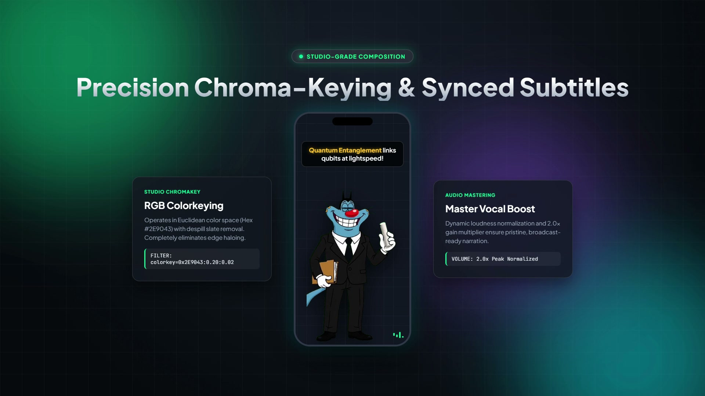
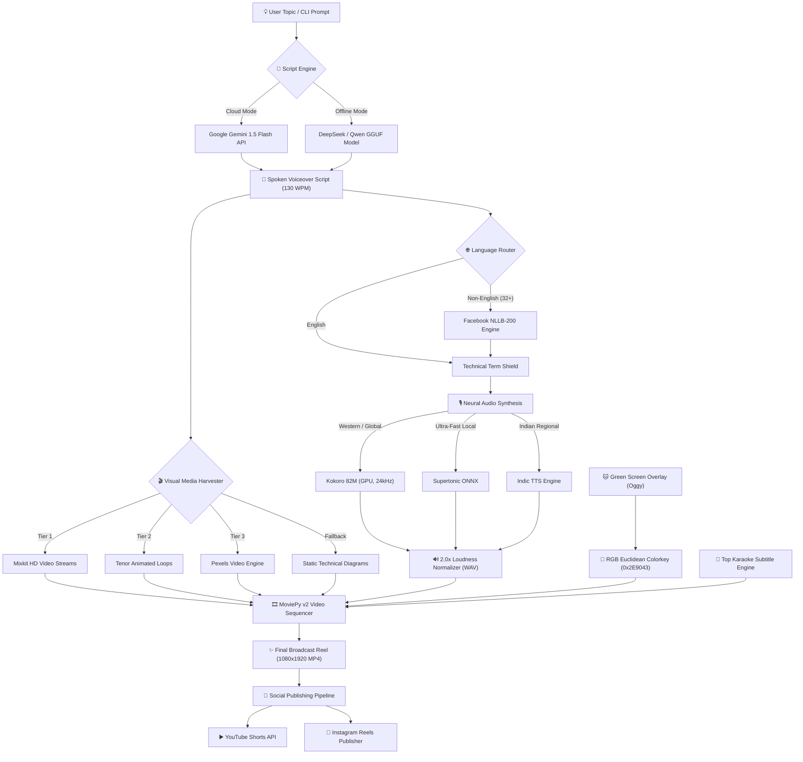

<div align="center">

# 🎬 AI REEL GENERATOR
### *Autonomous End-to-End Short-Form Video Production Studio*

[](https://www.python.org/)
[](https://developer.nvidia.com/cuda-toolkit)
[](https://ai.google.dev/)
[](https://huggingface.co/hexgrad/Kokoro-82M)
[](https://huggingface.co/facebook/nllb-200-distilled-600M)
[](LICENSE)

<br/>

**Transform a single topic prompt into a viral, fully-edited 9:16 vertical reel — complete with AI scriptwriting, neural voice synthesis, B-roll scraping, synced karaoke subtitles, precision Oggy chroma-keying, and direct social publishing.**

<br/>

---

### 🎥 Watch the Launch Showcase

[](assets/demo/brag.mp4)

> 💡 *Click the thumbnail above to play the full 1080p showcase video (`assets/demo/brag.mp4`)!*

---

</div>

<br/>

## 🌟 The Superpowers

<table>
  <tr>
    <td width="50%">
      <h3>⚡ 100% Autonomous Pipeline</h3>
      <p>Type <code>python main.py --topic "Quantum Computing"</code> and walk away. The engine scripts, narrates, gathers footage, keys overlays, burns subtitles, and renders a broadcast-ready 1080x1920 MP4 reel in under 60 seconds.</p>
    </td>
    <td width="50%">
      <h3>🧠 Dual-Brain LLM Engine</h3>
      <p>Seamlessly toggle between <b>Google Gemini 1.5 Flash</b> (cloud API with strict 130 WPM pacing and 5-attempt retry resilience) and <b>DeepSeek-R1 / Qwen 7B GGUF</b> (100% offline local inference via llama-cpp).</p>
    </td>
  </tr>
  <tr>
    <td width="50%">
      <h3>🎙️ Studio-Grade Neural TTS</h3>
      <p>Powered by <b>Kokoro 82M</b> and <b>Supertonic ONNX</b> for natural, lifelike voiceovers. Features automatic dynamic loudness normalization and a <b>2.0x vocal boost</b> to cut through mobile speakers without distortion.</p>
    </td>
    <td width="50%">
      <h3>🌐 32+ Multilingual Support</h3>
      <p>Local <b>Facebook NLLB-200</b> translation engine featuring a <b>Technical Term Shield</b> — protected engineering terms (e.g. <i>Voltage, Neural Network, GPU</i>) are preserved for natural, code-mixed regional speech.</p>
    </td>
  </tr>
  <tr>
    <td width="50%">
      <h3>🎬 3-Tier Waterfall B-Roll Scraper</h3>
      <p>Intelligently harvests relevant MP4 video clips and diagrams via a strict 3-tier sequence: <b>Mixkit → Tenor → Pexels</b>, applying stop-word filtering and topic keyword verification with automatic fallback to technical diagrams.</p>
    </td>
    <td width="50%">
      <h3>🐱 Precision RGB Euclidean Colorkey</h3>
      <p>Mathematical chroma-keying in RGB Euclidean space (Hex <code>#2E9043</code>) with despill slate elimination. Key out Oggy or custom characters with zero color contamination on blue fur, black suits, or white shirts.</p>
    </td>
  </tr>
  <tr>
    <td width="50%">
      <h3>💬 Top-Anchored Dynamic Subtitles</h3>
      <p>High-visibility karaoke captions positioned perfectly above content zones (anchored at <code>y=0.12</code>) with active word-by-word highlight colors to maximize viewer watch-time and retention.</p>
    </td>
    <td width="50%">
      <h3>🚀 1-Click Social Publishing</h3>
      <p>Built-in automation for <b>YouTube Shorts</b> (OAuth2 API with automated titles, tags, and category assignment) and <b>Instagram Reels</b> (direct session authentication with anti-bot throttling).</p>
    </td>
  </tr>
</table>

<br/>

## 🏗️ Architecture Blueprint



<br/>

## 🚀 Quickstart Guide

### ⚡ One-Click Automated Setup (Windows)

If you have Python, Git, and Chrome installed, run the automated setup script from the root directory:

```cmd
setup.bat
```

This will automatically:
1. Locate your Python interpreter and verify CUDA availability.
2. Initialize and activate the isolated virtual environment (`venv`).
3. Install all dependencies from `requirements.txt`.
4. Preload the NLLB-200 translation and Kokoro TTS models.
5. Launch the interactive CLI studio.

---

### 🛠️ Manual Installation

```powershell
# 1. Clone repository
git clone https://github.com/Prohith45/reel-generator.git
cd reel-generator

# 2. Create and activate Python 3.11 venv
py -3.11 -m venv venv
.\venv\Scripts\Activate.ps1

# 3. Install core dependencies with CUDA support
python -m pip install --upgrade pip setuptools wheel
pip install --prefer-binary -r requirements.txt

# 4. Copy and configure your environment
cp .env.example .env
```

---

## 💻 Command-Line Usage

### 🎯 Single Reel Generation (Headless / Non-Interactive)

Generate a complete reel with a single terminal command:

```powershell
python main.py --topic "Artificial General Intelligence" --duration 45 --llm api --tts kokoro --visuals hybrid --intro no
```

### ⚡ Unified 3-Step Automation Pipeline

Generate, verify, and publish to social channels in one command:

```powershell
python orchestrate.py --topic "How Black Holes Warp Time" --duration 50 --upload both
```

### 📋 CLI Flags & Parameters Reference

| Flag | Options / Format | Default | Description |
|---|---|---|---|
| `--topic` | `string` | *Interactive* | The core topic or concept for the reel |
| `--duration` | `30`, `45`, `60` | `45` | Target video length in seconds |
| `--llm` | `api`, `local` | `api` | Script reasoning model (Gemini Cloud vs GGUF) |
| `--tts` | `kokoro`, `supertonic`, `indic` | `kokoro` | Neural voice generation engine |
| `--visuals` | `hybrid`, `images` | `hybrid` | Use B-roll videos + diagrams or diagrams only |
| `--language` | `en`, `te`, `hi`, `es`, `fr`, ... | `en` | Spoken target language (32+ supported) |
| `--intro` | `yes`, `no` | `no` | Include Oggy chalkboard intro sequence |
| `--overlay` | `oggy1`, `oggy2`, `cat`, `none` | `oggy1` | Keyed character overlay video |
| `--non-interactive` | `flag` | `false` | Bypass all CLI interactive menus |

<br/>

## 🔑 Environment Configuration (`.env`)

Create a `.env` file in the repository root (see `.env.example`):

```env
# ==============================================================================
# LLM Script Generation (Google Gemini Cloud API)
# ==============================================================================
GEMINI_API_KEY=your_gemini_api_key_here

# ==============================================================================
# Media Scraping API Keys (Optional - Free tiers available)
# ==============================================================================
PEXELS_API_KEY=your_pexels_api_key_here
TENOR_API_KEY=your_tenor_api_key_here

# ==============================================================================
# Instagram Reels Publishing Credentials
# ==============================================================================
INSTAGRAM_USERNAME=your_instagram_handle
INSTAGRAM_PASSWORD=your_instagram_password
```

> 🔒 **Security Guarantee**: All secrets, OAuth tokens (`token.json`), API keys, and session cookies are strictly excluded from Git tracking via `.gitignore`.

<br/>

## 📂 Project Structure

```text
reel-generator/
├── main.py                     # Primary interactive & headless CLI orchestrator
├── orchestrate.py              # 3-step automated generate-verify-upload pipeline
├── config.yaml                 # Master configuration (video, overlays, tts, subtitles)
├── requirements.txt            # Python dependencies with PyTorch CUDA bindings
├── setup.bat                   # One-click Windows setup and launch script
│
├── src/                        # Core Engine Modules
│   ├── script_engine.py        # Gemini API & GGUF script generator (130 WPM bounded)
│   ├── tts.py                  # Kokoro 82M & Supertonic neural audio synthesis
│   ├── translation.py          # NLLB-200 multilingual router & technical term shield
│   ├── image_engine.py         # 3-tier waterfall B-roll scraper (Mixkit/Tenor/Pexels)
│   ├── subtitle_engine.py      # Top-anchored dynamic karaoke subtitle generator
│   └── video_engine.py         # MoviePy sequencer & RGB Euclidean colorkey filter
│
├── assets/                     # Media & Production Assets
│   ├── demo/                   # Showcase launch video and poster thumbnail
│   ├── green_screen/           # Chroma-key character video sources (Oggy, Cat)
│   ├── oggy_video/             # Chalkboard intro video clip
│   └── templates/              # Backgrounds and fallback diagrams
│
├── youtube_uploader.py         # YouTube Shorts OAuth2 uploader
└── instagram_uploader.py       # Instagram Reels mobile session uploader
```

<br/>

## 🛡️ License & Contributing

Distributed under the **MIT License**. See `LICENSE` for more information.

Contributions, feature suggestions, and bug reports are warmly welcomed! Feel free to open an issue or submit a pull request.

<div align="center">
  <sub>Built with ❤️ for content creators, educators, and engineers.</sub>
</div>
